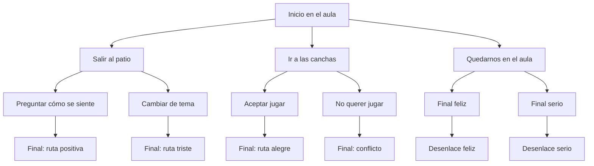

# Memorias de Primavera — Taller de novela visual con Unity y Naninovel

**Narrativa interactiva · Diseño de decisiones · Unity · Naninovel · Formación en videojuegos**

Preparé **Memorias de Primavera** como un ejercicio para enseñar a construir una **novela visual interactiva** en Unity. Desarrollé un **guion original con decisiones ramificadas y seis desenlaces**, acompañado de un tutorial ilustrado para trabajar con escenas, personajes, expresiones, diálogos y música.

Este repositorio reúne el **guion y los materiales educativos del taller**. Para ejecutar la experiencia se necesita un proyecto Unity configurado con **Naninovel**, una herramienta comercial que no se distribuye aquí.

[Consultar el tutorial ilustrado (PDF)](docs/tutorial-nani-novel-mejorado.pdf) · [Explorar el guion original](examples/textScript.nani) · [Preparar el entorno](docs/PREPARACION.md)

## La historia y el ejercicio

La historia sigue a **Ana y Luis**. A partir de una conversación, el jugador toma decisiones que modifican el recorrido narrativo y conducen a **seis finales diferentes**.

Utilicé esta estructura para mostrar cómo una historia puede convertirse en una experiencia interactiva mediante **elecciones, condiciones de navegación, cambios de escenario y expresiones de personajes**.

| Elemento | Contenido del guion |
| --- | --- |
| **Personajes** | Ana y Luis |
| **Expresiones** | Normal, Happy, Sad, Angry |
| **Escenarios** | Aula, Patio, Pasillo y Canchas |
| **Decisiones iniciales** | 3 |
| **Desenlaces** | 6 |
| **Música referenciada** | SchoolMemories y ABrightNewChapter |
| **Lenguaje de guion** | Archivos `.nani` |

## Cómo se ramifica la historia



Cada ruta permite practicar la relación entre **elecciones del jugador y secuencias del guion**.

## Un ejemplo con Naninovel

El guion utiliza comandos para cambiar el fondo, reproducir música, mostrar personajes y presentar elecciones:

```nani
@back Aula
@bgm SchoolMemories volume:0.2 fade:5

@char Ana.Normal pos:25 scale:0.6
Ana: La idea es que cada decisión pueda llevarnos a una escena diferente.

@char Luis.Normal pos:75 scale:0.6
Luis: Entonces... ¿por dónde empezamos?

@choice "Salir al patio" goto:.Patio
@choice "Ir a las canchas" goto:.Canchas
@choice "Quedarnos en el aula" goto:.AulaRuta

@stop
```

[Leer `textScript.nani` completo](examples/textScript.nani).

## Materiales que preparé

| Recurso | Para qué sirve |
| --- | --- |
| [Tutorial ilustrado en PDF](docs/tutorial-nani-novel-mejorado.pdf) | Recorrido en diez pasos por la preparación de recursos, personajes y configuración. |
| [Guion original](examples/textScript.nani) | Diálogos, elecciones, escenas y los seis desenlaces. |
| [Guía de preparación](docs/PREPARACION.md) | Instalación y configuración del entorno necesario. |
| [Inventario de código y recursos](docs/AUDITORIA-CODIGO.md) | Descripción del contenido seleccionado desde el proyecto histórico. |

## Cómo realizar el ejercicio

1. Instala **Unity Hub** y una versión de Unity compatible. El taller original utilizó **Unity 2023.2.20f1**.
2. Obtén e instala **Naninovel** mediante un canal autorizado. La versión empleada en el proyecto histórico fue **1.18.1**.
3. Prepara recursos gráficos y sonoros propios o correctamente licenciados. Para utilizar el guion sin modificarlo, registra los fondos `Aula`, `Patio`, `Pasillo` y `Canchas`; los personajes `Ana` y `Luis` con expresiones `Normal`, `Happy`, `Sad` y `Angry`; y las pistas `SchoolMemories` y `ABrightNewChapter`.
4. Sigue la [guía de preparación](docs/PREPARACION.md) y el [tutorial PDF](docs/tutorial-nani-novel-mejorado.pdf).
5. Integra [`textScript.nani`](examples/textScript.nani) a tu proyecto y comprueba cada ruta.

## Mi participación

Escribí el **guion narrativo**, estructuré sus elecciones y finales y preparé el material didáctico para explicar cómo desarrollar una novela visual en Unity con Naninovel.

El ejercicio combina dos áreas de mi trabajo: **desarrollo de experiencias interactivas y formación tecnológica**, mostrando cómo organizar una historia mediante reglas y decisiones que el jugador puede explorar.

## Sobre los recursos

**Naninovel es un producto comercial** y sus componentes no están incluidos. Tampoco se distribuyen los fondos, personajes o pistas del proyecto original, cuyo uso depende de sus respectivas licencias.

El repositorio ofrece el **guion y la documentación de enseñanza**, no un proyecto Unity listo para ejecutar sin preparación. Los materiales propios aquí publicados no cuentan actualmente con una licencia de reutilización explícita.

---

[Volver a mi portafolio profesional](https://github.com/isaiassolis) · [Taller Chrome Dino](https://github.com/isaiassolis/unity-2d-chrome-dino-workshop) · [Taller DrawFight](https://github.com/isaiassolis/unity-2d-platformer-workshop)
