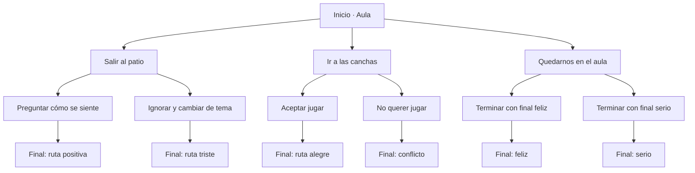

# Memorias de Primavera
### Taller práctico · Novela visual interactiva con Unity y Naninovel

**Guion original, decisiones ramificadas y tutorial ilustrado para aprender a construir una novela visual.**

[](https://unity.com/)
[-6C4AB6)](https://naninovel.com/)
[](docs/tutorial-nani-novel-mejorado.pdf)
[](docs/AUDITORIA-CODIGO.md)

**[📖 Abrir tutorial PDF](docs/tutorial-nani-novel-mejorado.pdf)** · **[💻 Explorar el guion .nani](examples/textScript.nani)** · **[🛠️ Preparar el entorno](docs/PREPARACION.md)**

> **Alcance:** este repositorio publica el **guion narrativo original y materiales didácticos**, no un proyecto Unity ejecutable. **Naninovel es un producto comercial y no está incluido**. Para seguir el taller se necesita una instalación legítima y recursos gráficos y sonoros autorizados.

## El proyecto

*Memorias de Primavera* es un ejercicio de narrativa interactiva protagonizado por **Ana y Luis**. Mediante decisiones sencillas, el estudiante observa cómo los cambios de escenario, expresión y diálogo conducen a **seis desenlaces distintos**.

El material se desarrolló como apoyo para un taller práctico. Su objetivo es enseñar a estructurar una experiencia narrativa en Unity utilizando el lenguaje de scripts de Naninovel, sin presentar el ejemplo como un videojuego comercial terminado.

| Elemento | Implementación en el guion |
| --- | --- |
| Personajes | Ana y Luis |
| Expresiones | Normal, Happy, Sad y Angry |
| Escenarios | Aula, Patio, Pasillo y Canchas |
| Elecciones iniciales | 3 |
| Desenlaces | 6 |
| Música referenciada | SchoolMemories y ABrightNewChapter |
| Lenguaje narrativo | Scripts `.nani` |

## Mapa de decisiones

El siguiente diagrama representa las **rutas reales** definidas en [`textScript.nani`](examples/textScript.nani).



Cada ruta sirve para practicar cambios de fondos, poses de personajes, música y saltos entre etiquetas. El diagrama es una **representación del código**, no una captura de una ejecución verificada.

## Fragmento del guion

Las elecciones se escriben en el archivo `.nani` y apuntan a etiquetas que contienen las escenas correspondientes:

```nani
@back Aula
@bgm SchoolMemories volume:0.2 fade:5

@char Ana.Normal pos:25 scale:0.6
Ana: La idea es que cada decisión pueda llevarnos a una escena diferente.

@char Luis.Normal pos:75 scale:0.6
Luis: Entonces... ¿por dónde empezamos?

@choice "Salir al patio" goto:.Patio
@choice "Ir a las canchas" goto:.Canchas
@choice "Quedarnos en el aula" goto:.AulaRuta

@stop
```

**[Consultar el guion completo →](examples/textScript.nani)**

## Material del taller

| Recurso | Qué encontrarás |
| --- | --- |
| **[Tutorial ilustrado (PDF)](docs/tutorial-nani-novel-mejorado.pdf)** | Diez pasos para preparar y registrar recursos, configurar personajes y personalizar la experiencia. |
| **[Guion original .nani](examples/textScript.nani)** | Diálogos, cambios de expresiones, elecciones y seis desenlaces. |
| **[Guía de preparación](docs/PREPARACION.md)** | Requisitos, estructura sugerida y cómo incorporar el guion en un proyecto propio. |
| **[Auditoría del proyecto original](docs/AUDITORIA-CODIGO.md)** | Alcance de lo publicable y exclusiones por dependencias o licencias. |

**Vista previa:** el [PDF ilustrado](docs/tutorial-nani-novel-mejorado.pdf) contiene la portada y las capturas utilizadas para explicar el proceso. No se ha extraído una imagen independiente para el README, a fin de conservar la presentación original y evitar una captura engañosa.

## Competencias trabajadas

- **Narrativa interactiva:** estructura de decisiones, etiquetas y rutas alternativas.
- **Unity:** organización de recursos y preparación de escenas.
- **Naninovel:** registro de fondos y personajes, control de expresiones y audio.
- **Diseño didáctico:** desarrollo de un ejemplo progresivo y tutorial visual.
- **Validación funcional:** revisión de las distintas rutas como actividad propuesta para el estudiante.

## Cómo utilizar este repositorio

1. Instala Unity Hub y un editor Unity compatible. El proyecto histórico usó **Unity 2023.2.20f1**.
2. Adquiere e instala **Naninovel por un canal autorizado**; la versión utilizada en el proyecto histórico fue **1.18.1**.
3. Prepara imágenes y audio **propios o con licencia válida**. El guion requiere fondos `Aula`, `Patio`, `Pasillo`, `Canchas`; personajes `Ana` y `Luis` con expresiones `Normal`, `Happy`, `Sad`, `Angry`; y pistas `SchoolMemories` y `ABrightNewChapter`. También puedes modificar el guion para usar otros identificadores.
4. Sigue la **[guía de preparación](docs/PREPARACION.md)** y el **[tutorial PDF](docs/tutorial-nani-novel-mejorado.pdf)** para registrar los recursos.
5. Incorpora **[`examples/textScript.nani`](examples/textScript.nani)** a tu proyecto, configúralo como script ejecutable y comprueba las seis rutas.

> **Nota técnica:** el tutorial acompaña el proyecto utilizado en clase; no es una instalación autónoma desde cero. Las rutas y opciones de Naninovel pueden variar según la versión.

## Autoría, dependencias y estado

**Material didáctico y guion:** Isaías Solís Aranda.

Naninovel, su código y sus componentes son propiedad de sus respectivos titulares y **no se redistribuyen**. Tampoco se incluyen los fondos, personajes ni pistas del proyecto histórico porque no se han verificado sus permisos de redistribución. Los archivos propios de este repositorio no tienen por ahora una licencia de reutilización explícita.

La [auditoría técnica](docs/AUDITORIA-CODIGO.md) describe lo que se revisó. **No se ha ejecutado una reconstrucción limpia en Unity** con los archivos de este repositorio, por lo que no se afirma que sea un proyecto listo para abrir o compilar.

---

**[← Volver al portafolio profesional](https://github.com/isaiassolis)** · [Taller Chrome Dino 2D](https://github.com/isaiassolis/unity-2d-chrome-dino-workshop) · [Taller de plataformas 2D](https://github.com/isaiassolis/unity-2d-platformer-workshop)
